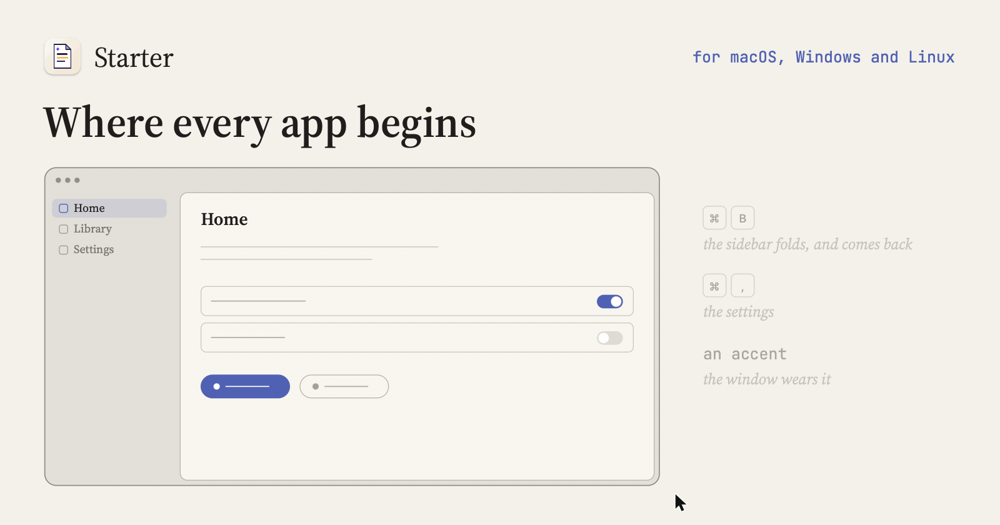

<p align="center"></p>

# Starter

The template every Alkaline Software app begins from: a Rust and GPUI desktop app for macOS, Windows and Linux.

```
cargo build -p starter-app && ./target/debug/Starter
```

MIT licensed.
